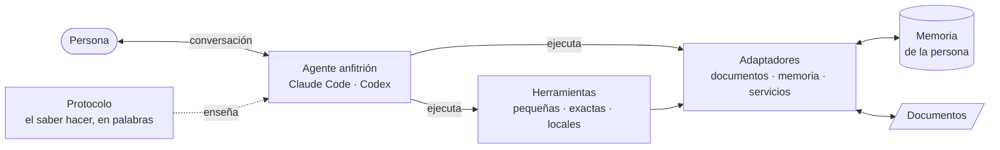
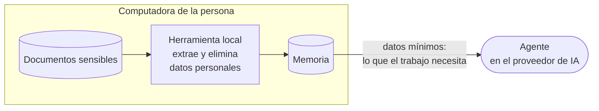

# Howware: del saber hacer a hecho

**Whitepaper sobre cómo poner un saber hacer a trabajar con IA, sin construir una app**

*Versión 0.2 · octubre de 2026 · [Read in English](../whitepaper.md)*

---

## Resumen

Casi todo el software existe para poner a trabajar el saber hacer de alguien: las reglas de un negocio, los
criterios de una profesión, los hábitos de un hogar. Hoy ese saber hacer llega a la computadora a través de un
intermediario —quien sabe se lo explica a quien programa— y de un contenedor: una aplicación con pantallas,
formularios y un backend. Las dos cosas son lentas y caras, y cada regla nueva las vuelve más lentas y más caras.

Los agentes de IA capaces de seguir instrucciones escritas, usar herramientas locales y sostener una conversación
hacen posible otro camino. La persona escribe su saber hacer como un **protocolo**, con sus palabras; solo las
operaciones que deben ser exactas se vuelven **herramientas** pequeñas; **adaptadores** reutilizables las
conectan con documentos y almacenes de datos y dejan los datos personales en el borde; el estado de la persona vive
en una **memoria** que es suya; y la **conversación** es la interfaz. Al resultado lo llamamos **howware**.

Este documento define el término, lo ubica después de la hoja de cálculo en la historia de la computación para
usuarios finales, describe su anatomía y sus principios, enumera los patrones y antipatrones que encontramos al
construir el primer howware —finanzas personales sin app— y es explícito sobre sus límites: lo que no puede
garantizar y cuándo una app sigue siendo mejor opción. Cierra con las preguntas abiertas para llevar el howware
del uso personal a los equipos de trabajo y al software empresarial.

## 1. El problema de los intermediarios

Piensa en cualquier trabajo lleno de reglas: categorizar gastos, aprobar compras, clasificar solicitudes de
soporte, dar seguimiento a mantenimientos. Quien sabe cómo debe funcionar casi nunca construye el software que lo
hace. En cambio:

1. Le explica las reglas a alguien que programa, en juntas, documentos y tickets.
2. Las reglas se traducen a código. Se pierde sentido: los casos especiales, la intención, el «depende».
3. Cada regla nueva interactúa con las anteriores; el código se vuelve más complicado que las reglas mismas.
4. Cada cambio vuelve a recorrer el mismo camino y espera su turno. Semanas o meses después, lo que se necesitaba
   puede haber cambiado.

Alrededor de las reglas, además, alguien tiene que construir el **contenedor**: pantallas, formularios,
navegación, cuentas, un backend, sincronización. Y quienes lo usan tienen que aprender dónde está cada cosa y
adaptarse a decisiones que tomó alguien más.

Muy poco de eso es el trabajo. El trabajo es el saber hacer.

## 2. Definición

> **Howware** — tu saber hacer, puesto a trabajar con IA. Dices las reglas con tus palabras; un agente de IA las
> sigue, con unas cuantas herramientas exactas y una memoria que es tuya. Sin app que construir, sin
> intermediarios, sin esperas.

*El hardware lo corre. El software lo ejecuta. El howware sabe cómo.*

**Un howware** (también se usa como sustantivo contable: *un howware de finanzas*, *dos howwares*) es un artefacto
concreto: un protocolo, un conjunto de herramientas, los adaptadores que usa y una convención de memoria, instalados en un agente anfitrión
como Claude Code o Codex. Se puede versionar, probar, compartir, auditar y combinar como cualquier otro software.

## 3. El siguiente paso después de la hoja de cálculo

La hoja de cálculo es la herramienta de programación para usuarios finales más exitosa que se ha hecho, por una
razón: eliminó al intermediario. Un contador podía poner su saber hacer a trabajar directamente —reglas como
fórmulas, una cuadrícula como interfaz, cambios que surten efecto al instante— sin pedírselo a un programador.

El howware lleva la misma idea más lejos:

| | Hoja de cálculo | Howware |
|---|---|---|
| Las reglas se escriben como | Fórmulas | Las palabras de la persona |
| La interfaz es | Una cuadrícula | Una conversación |
| Los datos entran | Escribiendo o pegando | Con herramientas que leen documentos |
| Quién hace el trabajo | La persona, celda por celda | Un agente de IA, siguiendo las reglas |
| El criterio («depende») | Difícil de expresar | Natural de expresar; el agente pregunta cuando duda |
| La exactitud | Integrada | Delegada a herramientas; las reglas requieren aprobación |
| Un cambio surte efecto | Al escribirlo | En la siguiente conversación |

La comparación también muestra el costo. Una fórmula es exacta y visible; una regla en palabras no lo es. El
howware lo compensa de tres formas (§5): las operaciones exactas viven en herramientas con pruebas, el agente
propone y la persona aprueba, y todo howware dice cuáles son sus límites.

## 4. Anatomía

| Parte | Contiene | Se escribe en | Debe ser |
|---|---|---|---|
| **Protocolo** | El saber hacer: pasos, criterios, qué preguntar, qué nunca hacer, cómo presentar resultados | Lenguaje natural (un archivo de skill) | Legible para la persona dueña del saber hacer; específico; verificable conversando |
| **Herramientas** | Las operaciones exactas de este trabajo: aritmética, fechas, identificadores, validación | Código, en el howware | Pequeñas, deterministas, sin red, con salida legible por máquina y errores explícitos |
| **Adaptadores** | El acceso al entorno: leer documentos, el almacén de la memoria, servicios | Código, en su propio repositorio | Reutilizables por varios howwares; sin reglas de ningún trabajo; quitan los datos personales en el borde |
| **Memoria** | El estado de la persona, las reglas que enseñó y la historia | Un almacén local con esquema estable | Propiedad de la persona, portátil, solo de agregado o versionado |
| **Conversación** | La interfaz | Las palabras de la persona | — |

El **agente anfitrión** no es parte del howware. Es el entorno de ejecución —como el navegador para una página
web— que carga el protocolo, ejecuta las herramientas con permiso de la persona y conversa con ella. Un howware
debería funcionar en más de un anfitrión.

### 4.1 Dónde viven las reglas

Las reglas aparecen en dos lugares, y la diferencia importa:

- **Las reglas del trabajo** —cómo se hace para todos— viven en el **protocolo**: «el pago a tu propia tarjeta no
  es gasto», «propón las categorías nuevas siempre en un solo mensaje».
- **Las reglas de la persona** —lo que esta persona enseñó— viven en la **memoria**, como datos: «OXXO es súper»,
  «4,000 al mes para súper». La persona las crea conversando; surten efecto de inmediato y tienen historia.

Ninguna requiere código. El código se reserva para la frontera de la exactitud.

### 4.2 La frontera de la exactitud

| Va en una **herramienta** o un **adaptador** (código) | Va en el **protocolo** o en la **memoria** (palabras) |
|---|---|
| Leer el formato de un documento | Qué documentos pedir |
| Sumas, saldos, dinero en centavos | Qué significa un número y si importa |
| Identificadores estables y evitar duplicados | Que un comercio es «súper» |
| Fechas, zonas horarias, periodos | Cuándo preguntar en lugar de adivinar |
| Eliminar datos personales | Qué advertencias importan este mes |
| Escribir y consultar el almacén | Qué preguntarle al almacén |
| Validar y rechazar entradas inseguras | Explicar por qué se rechazó algo |

Regla práctica: **si un error pasaría en silencio, va en una herramienta.** Si sería visible y la persona podría
corregirlo conversando, pueden ser palabras.

### 4.3 Adaptadores: el borde

El código se divide en dos. Las **herramientas** son de un howware y hacen las operaciones exactas de su trabajo.
Los **adaptadores** se comparten: conectan a los howwares con el entorno (el formato del estado de cuenta de un
banco, las facturas del SAT, la base de datos de la memoria y, algún día, un servidor de correo o un sistema de la
empresa), igual que los puertos y adaptadores mantienen el núcleo de una arquitectura limpia sin saber dónde corre.
Tres reglas hacen útil la división:

1. **Los adaptadores no tienen reglas de ningún trabajo.** Un adaptador de documentos del SAT no sabe que una
   exportación de servicios va a tasa 0 %; lo copia de una plantilla tomada de una factura que la persona ya
   emitió. Las decisiones se quedan con la persona y en el núcleo.
2. **La privacidad se protege en el borde.** El adaptador que abre un documento sensible es el que quita o
   reemplaza con seudónimos los datos personales, antes de que el agente vea nada, y prefiere retener su salida a
   filtrar algo.
3. **El núcleo llega al entorno solo a través de adaptadores.** El protocolo dice qué adaptador ejecutar; las
   herramientas llaman a adaptadores en lugar de abrir archivos o bases de datos por su cuenta.

Como los adaptadores se comparten, un howware nuevo muchas veces no necesita un adaptador nuevo, y un adaptador
nuevo hace posibles otros howwares: [mxbank](https://github.com/howware/mx-bank-statement-reader) sirve a las
finanzas personales y a la facturación; [mxsat](https://github.com/howware/mx-sat-documents) sirve a la
facturación; la [memoria](https://github.com/howware/long-term-memory-for-AI) sirve a todos.

## 5. Principios

El [manifiesto](../../MANIFIESTO.md) enuncia nueve principios:

1. Quien tiene el saber hacer es el autor.
2. La conversación es la interfaz.
3. Programa solo lo que debe ser exacto.
4. El agente decide; las herramientas hacen el trabajo.
5. La persona aprueba.
6. Los datos son de la persona.
7. Privacidad por diseño, dicha con honestidad.
8. Tan pequeño que se pueda auditar.
9. Componible y abierto.

## 6. Patrones

Salen de construir [finanzas-personales](https://github.com/howware/finanzas-personales). Cada uno resolvió una
falla real.

**P1 · Extraer localmente, antes del modelo.** Los documentos sensibles los procesa una herramienta local que
entrega solo lo que el trabajo necesita, sin datos personales. El agente nunca abre el original. *Finanzas:* un
lector de estados de cuenta elimina nombres, RFC, números de tarjeta y de cuenta, y vuelve seudónimos a las
contrapartes antes de que nada más vea los datos.

**P2 · Identificadores estables, escrituras idempotentes.** Cada registro recibe un identificador derivado de
datos estables de la fuente —con un hash con llave cuando las entradas son adivinables—, así que importar dos veces
el mismo documento, o documentos que se enciman en cualquier orden, nunca duplica.

**P3 · Las herramientas mueven datos; el agente nunca transcribe.** El agente no copia cientos de renglones en una
llamada a una herramienta. Una herramienta lee la fuente y escribe el almacén en un solo paso atómico; el agente
recibe un resumen.

**P4 · Aritmética exacta en la unidad mínima.** El dinero se guarda como centavos enteros con una unidad declarada.
El agente nunca suma montos por su cuenta; los reportes salen de la agregación del propio almacén.

**P5 · Reglas sobre entidades, no etiquetas sobre registros.** La categoría es una regla sobre el comercio (o la
contraparte, o el tipo de movimiento), no una etiqueta escrita en cada movimiento. Cambiar la regla recategoriza
toda la historia sin reescribir un solo registro; las excepciones puntuales son eventos aparte que tienen
prioridad.

**P6 · Proponer en bloque; la persona aprueba.** Después de importar, el agente agrupa todo lo nuevo en una sola
propuesta. Una corrección se vuelve regla. Las palabras literales de la persona se guardan como evidencia de la
decisión.

**P7 · Mostrar lo pendiente al empezar.** Un resumen al inicio de cada sesión muestra lo que necesita atención —un
pago por vencer, dinero sin categoría— para que la persona nunca tenga que preguntar. Los registros de alto volumen
quedan fuera del resumen.

**P8 · Preguntas guardadas.** Las preguntas que se repiten se guardan en la memoria como consultas con nombre y
parámetros, para que el agente reutilice una consulta probada en lugar de improvisar.

**P9 · Rechazar entradas inseguras; fallar de forma cerrada.** Las herramientas rechazan entradas que corromperían
el estado o filtrarían datos. Un rechazo claro es mejor que un resultado parcial en silencio.

**P10 · Verificar versiones entre piezas.** Las piezas componibles evolucionan por separado. Cada herramienta
verifica las versiones de las que depende y dice exactamente qué actualizar.

**P11 · Proteger el repositorio.** El repositorio de un howware nunca debe recibir datos reales de la persona; una
revisión en CI rechaza documentos, bases de datos y cualquier cosa que parezca un identificador personal.

**P12 · Detalles aburridos que muerden.** Guardar las fechas de calendario a mediodía en la zona local; usar una
sola definición de «vigente» en todas las lecturas; que las fechas muy lejanas funcionen. Los agentes combinan
muchas consultas y amplifican las pequeñas inconsistencias.

## 7. Antipatrones

| Antipatrón | Por qué falla | En su lugar |
|---|---|---|
| Subir el documento original al modelo | Entrega datos personales a un tercero; puede leerlo mal | P1 |
| El agente transcribe registros a una herramienta | Lento, caro y con pérdidas silenciosas | P3 |
| El agente hace las cuentas | Totales plausibles pero equivocados | P4 |
| Archivos Markdown como base de datos | Se desvían, se contradicen, sin historia ni consultas | Una memoria real con esquema |
| Sobrescribir registros | No hay forma de explicar ni deshacer un cambio | Solo agregar; cerrar o anular con motivo |
| Rehacer una app como menús de chat («escribe 1 para…») | Conserva el costo de una app y pierde la conversación | Que la persona hable; el protocolo interpreta la intención |
| Decidir por la persona | Las reglas equivocadas se acumulan en silencio | P6 |
| Poner el criterio en código | Regresa al intermediario | Reglas en el protocolo o la memoria |
| Prometer más privacidad de la que se da | Destruye la confianza la primera vez que resulta falso | Decir lo que no se puede garantizar |

## 8. Privacidad y confianza

Un howware tiene una frontera clara entre lo que se queda en la computadora de la persona y lo que ve el agente
—y, por lo tanto, el proveedor de IA.

Un howware honesto dice tres cosas:

- **Qué está diseñado para quedarse local:** los documentos originales, los identificadores directos y el almacén
  mismo (el agente le hace consultas y ve las respuestas).
- **Qué ve el agente:** los datos mínimos que necesita, los resultados de sus consultas y todo lo que escribe la
  persona. Eso sale de la computadora y queda sujeto a los términos del proveedor.
- **Qué no se puede garantizar:** la anonimización automática no es infalible; «nunca abras el documento» es una
  instrucción al agente, no una barrera física (los permisos del anfitrión reducen el riesgo pero no lo eliminan);
  los almacenes locales normalmente no están cifrados.

La confianza viene de que **se pueda auditar**, no de promesas: el protocolo es un archivo de texto, las
herramientas son cortas, cada afirmación enlaza al código que la implementa y todo es código abierto.

## 9. Cuándo no conviene howware

El howware es un método, no una doctrina. Construye una app cuando:

- **El trabajo es visual o espacial:** herramientas de diseño, mapas, video, juegos.
- **Es en tiempo real o de alta frecuencia:** pantallas de operación bursátil, tableros que alguien vigila todo el
  día, punto de venta.
- **Dominan la latencia o el costo por interacción:** una vuelta con el agente cuesta segundos y tokens; un botón
  cuesta milisegundos.
- **Muchas personas actúan sobre el mismo estado al mismo tiempo** y necesitan garantías fuertes de concurrencia
  (por ahora; ver §11).
- **Las personas involucradas no pueden o no deben usar un agente:** necesidades de accesibilidad, contextos
  regulados que exigen software certificado, entornos sin acceso a IA.
- **No hay criterio en el trabajo:** si cada paso es determinista, un script o una hoja de cálculo pueden ser más
  simples.

Una buena prueba: *si le quitaras las pantallas a la app que tienes en mente, ¿se conservaría la mayor parte de su
valor?* Si la respuesta es sí, es candidata a howware.

## 10. Cómo se compara

| | Qué se construye | Quién escribe las reglas | Dónde vive la lógica |
|---|---|---|---|
| App tradicional | Una app (interfaz + backend) | Programadores, a partir de requisitos | Código |
| Hoja de cálculo | Un libro de cálculo | La persona | Fórmulas |
| No-code | Una app, de forma visual | La persona o un analista | Configuración visual |
| Vibe coding | Una app, con IA escribiendo el código | Quien escribe el prompt; luego la mantienen programadores | Código escrito por IA |
| Chatbot | Una conversación sobre lo que sabe un modelo | Nadie en particular | El modelo |
| Frameworks de agentes | Agentes, hechos por programadores | Programadores | Código que orquesta modelos |
| **Howware** | **Un protocolo + herramientas pequeñas + adaptadores compartidos + una convención de memoria** | **Quien tiene el saber hacer** | **Palabras (criterio) + herramientas (exactitud)** |

## 11. Del uso personal a los equipos y la empresa

Los primeros howwares son personales: una persona, una computadora, una memoria. Llevar el enfoque a equipos de
trabajo y software empresarial plantea preguntas que este proyecto quiere explorar abiertamente:

| Tema | Personal (hoy) | Equipos y empresa (preguntas abiertas) |
|---|---|---|
| Autoría | La persona escribe las reglas | ¿Quién puede cambiar qué reglas? Revisión y aprobación de cambios al protocolo |
| Identidad | La persona dueña | ¿Quién está hablando? Ligar la conversación a una identidad |
| Memoria | Un archivo local | Estado compartido, concurrencia, residencia de datos, respaldos |
| Permisos | El anfitrión pregunta antes de ejecutar herramientas | Acceso por rol a herramientas y datos; mínimo privilegio |
| Integración | Adaptadores para documentos locales y la memoria | Adaptadores para correo, bases de datos y sistemas internos de la empresa, con acceso por rol |
| Procesos | El protocolo | Procesos versionados con roles, aprobaciones y plazos |
| Auditoría | Historia de solo agregado con autor y evidencia | Rastros de nivel de cumplimiento entre personas y agentes |
| Calidad | Pruebas de herramientas; conversaciones revisadas a mano | Evaluación de regresiones de protocolos entre versiones de modelos |
| Distribución | Instalar un skill | Paquetes de protocolo firmados y revisados; registros internos |
| Costo | Una suscripción personal | Costo por trabajo; cuándo es más barata una app (§9) |

Algunas bases ya existen: la memoria que usa el primer howware soporta procesos versionados, roles, pendientes por
persona o por rol, y un actor en cada registro. Si eso alcanza para flujos reales de equipo es lo que deben mostrar
los siguientes experimentos.

## 12. Caso de estudio: finanzas personales sin app

[finanzas-personales](https://github.com/howware/finanzas-personales) es el howware de referencia.

| Parte | Implementación |
|---|---|
| Protocolo | `SKILL.md`: arranque, importación, categorías (12 grupos fijos; subcategorías propuestas y aprobadas), efectivo, presupuestos, pagos de tarjeta, cierre de mes, reglas de presentación y de privacidad |
| Herramientas | `fin.py` (≈600 líneas, solo biblioteca estándar): importación, categorías, presupuestos, reportes |
| Adaptadores | [mxbank](https://github.com/howware/mx-bank-statement-reader) (PDF del estado de cuenta → JSON anonimizado, conciliado y con ids estables) y la memoria |
| Memoria | [Long-Term Memory for AI](https://github.com/howware/long-term-memory-for-AI): SQLite local, solo de agregado, hechos con vigencia, consultas guardadas |
| Anfitriones | Claude Code (Codex aún sin probar) |

**Reglas que nunca necesitaron código.** Todo lo que la persona enseña son datos en la memoria, creados conversando:
las categorías de los comercios («OXXO es súper»), las subcategorías nuevas, las excepciones puntuales («lo de
Amazon fue un regalo»), los nombres de las personas con seudónimo («PERSONA_7f3a es mi casero»), los presupuestos
mensuales y sus cambios en el tiempo. Las reglas del trabajo —qué no es gasto, cómo proponer categorías, de qué
advertir al cierre de mes— son oraciones en el protocolo, que cualquiera que las lea puede editar.

**Lo que sí necesitó código.** Leer el formato de cada banco, eliminar datos personales, conciliar saldos,
identificadores estables, aritmética en centavos, fechas, importación idempotente, las consultas del almacén. Cada
patrón de §6 salió de una falla en alguno de estos puntos: importaciones duplicadas antes de los ids estables,
errores de redondeo antes de los centavos enteros, un día de desfase antes de las fechas a mediodía, una
recategorización que habría obligado a reescribir la historia antes de las reglas sobre entidades, y una promesa de
privacidad que tuvo que reescribirse porque prometía más de lo que el sistema podía garantizar.

Rendimiento con 50,000 movimientos: reportes agrupados en cerca de 1.5 segundos, incluido el arranque del proceso.

**Lo que siguió.** Un segundo howware, [todo](https://github.com/howware/todo) (Getting Things Done), se construyó con
el proceso de `howware-builder` y reutiliza el adaptador de memoria. Un tercero, [facturacion](https://github.com/howware/facturacion), combina el
adaptador de estados de cuenta con uno nuevo para documentos del SAT: los depósitos que llegan al banco se vuelven
las facturas por emitir.

## 13. Preguntas abiertas

- **Calidad del protocolo.** ¿Cómo se prueba un protocolo de forma sistemática? ¿Cómo sería una batería de pruebas
  de regresión para «el agente sigue las reglas» entre versiones de modelos?
- **Portabilidad.** ¿Qué tanto de un protocolo depende del anfitrión? ¿Puede un howware funcionar igual en varios?
- **Descubrimiento.** Las apps tienen tiendas. ¿Cómo encuentran, confían e instalan howwares las personas?
- **Modos de falla.** ¿Qué pasa cuando el agente ignora el protocolo? ¿Qué garantías deben pasar de las palabras a
  las herramientas o a los permisos del anfitrión?
- **Economía.** ¿Para qué trabajos un howware es más barato que una app a lo largo de su vida, y para cuáles no?

Son invitaciones. Howware es una idea abierta; se reciben contribuciones, contraejemplos y howwares nuevos.

## Referencias

- [El manifiesto howware](../../MANIFIESTO.md)
- [Especificación de un howware](especificacion.md)
- [finanzas-personales](https://github.com/howware/finanzas-personales): howware de referencia
- [mx-bank-statement-reader](https://github.com/howware/mx-bank-statement-reader): herramienta de extracción local
- [Long-Term Memory for AI](https://github.com/howware/long-term-memory-for-AI): memoria

---

*Texto bajo licencia [CC BY 4.0](https://creativecommons.org/licenses/by/4.0/deed.es). Cítese como: Pinto, A.
(2026). Howware: del saber hacer a hecho. https://howware.org*
