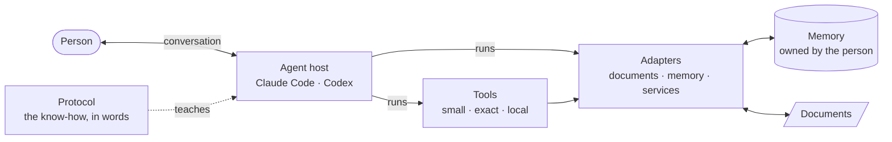
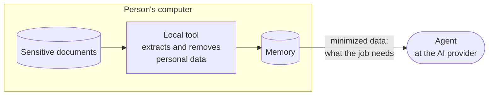

# Howware: From Know-How to Done

**A whitepaper on putting know-how to work with AI, without building an app**

*Version 0.2 · October 2026 · [Leer en español](es/whitepaper.md)*

---

## Abstract

Most software exists to put someone's know-how to work: the rules of a business, the criteria of a profession,
the habits of a household. Today that know-how reaches a computer through a handoff — the person who knows
explains it to someone who codes — and through a container: an application with screens, forms and a backend.
Both are slow and expensive, and every new rule makes them more so.

AI agents that can follow written instructions, run local tools and hold a conversation make a different path
possible. The person writes the know-how as a **protocol** in their own words; only the operations that must be
exact become small **tools**; reusable **adapters** connect them to documents and data stores, keeping personal
data at the edge; the person's state lives in a **memory** they own; and the **conversation** is the interface. We
call the result **howware**.

This paper defines the term, places it after the spreadsheet in the history of end-user computing, describes its
anatomy and principles, lists the patterns and anti-patterns found while building the first howware — personal
finance with no app — and is explicit about its limits: what it cannot guarantee, and when an app is still the
better choice. It closes with the open questions for taking howware from personal use to teams and enterprise
software.

## 1. The handoff problem

Consider any rule-heavy job: categorizing expenses, approving purchases, triaging support requests, tracking
maintenance. The person who knows how it should work rarely builds the software that does it. Instead:

1. They explain the rules to someone who codes — in meetings, documents, tickets.
2. The rules are translated into code. Meaning is lost: edge cases, intent, the "it depends".
3. Each new rule interacts with the previous ones; the code grows more complicated than the rules themselves.
4. Every change goes back through the same path and waits its turn. Weeks or months later, what was needed may
   have changed.

Around the rules, someone also has to build the **container**: screens, forms, navigation, accounts, a backend,
sync. Users, in turn, have to learn where everything is and adapt to choices someone else made.

Very little of that is the job. The job is the know-how.

## 2. Definition

> **Howware** — your know-how, put to work by AI. You state the rules in your own words; an AI agent follows
> them, with a few exact tools and a memory you own. No app to build, no one to hand it off to, no waiting.

*Hardware runs it. Software executes it. Howware knows how.*

A **howware** (the noun is also countable: *a finance howware*, *two howwares*) is a concrete artifact: a
protocol, a set of tools, the adapters it uses and a memory convention, installed into an agent host such as Claude Code or Codex. It
can be versioned, tested, shared, audited and composed like any other software.

## 3. The next step after the spreadsheet

The spreadsheet is the most successful end-user programming tool ever made, for one reason: it removed the
handoff. An accountant could put their know-how to work directly — rules as formulas, a grid as the interface,
changes effective immediately — without asking a programmer.

Howware takes the same idea further:

| | Spreadsheet | Howware |
|---|---|---|
| Rules are written as | Formulas | The person's own words |
| The interface is | A grid | A conversation |
| Data gets in by | Typing or pasting | Tools that read documents |
| Who does the work | The person, cell by cell | An AI agent, following the rules |
| Judgment ("it depends") | Hard to express | Natural to express; the agent asks when unsure |
| Exactness | Built in | Delegated to tools; rules need approval |
| A change takes effect | When typed | In the next conversation |

The comparison also shows the cost. A formula is exact and visible; a rule in words is not. Howware compensates
in three ways (§5): exact operations live in tested tools, the agent proposes and the person approves, and every
howware states its limits.

## 4. Anatomy

| Part | Holds | Written in | Must be |
|---|---|---|---|
| **Protocol** | Know-how: steps, criteria, what to ask, what never to do, how to present results | Natural language (a skill file) | Readable by the person who owns the know-how; specific; testable by conversation |
| **Tools** | The exact operations of this job: arithmetic, dates, identifiers, validation | Code, in the howware | Small, deterministic, offline, machine-readable output, explicit errors |
| **Adapters** | Access to the environment: reading documents, the memory store, services | Code, in its own repository | Reusable by many howwares; no rules of any job; personal data removed at the edge |
| **Memory** | The person's state, the rules they taught, and history | A local store with a stable schema | Owned by the person, portable, append-only or versioned |
| **Conversation** | The interface | The person's own words | — |

The **agent host** is not part of the howware. It is the runtime — like a browser for a web page — that loads
the protocol, runs tools with the person's permission and talks to them. A howware should run on more than one
host.

### 4.1 Where rules live

Rules appear in two places, and the difference matters:

- **Rules of the job** — how the work is done for everyone — live in the **protocol**: "a payment to your own
  card is not spending", "always propose new categories in a single message".
- **Rules of the person** — what this person taught — live in the **memory**, as data: "OXXO is groceries",
  "4,000 a month for groceries". The person creates them in conversation; they take effect immediately and have
  history.

Neither requires code. Code is reserved for the exactness boundary.

### 4.2 The exactness boundary

| Goes in a **tool** or an **adapter** (code) | Goes in the **protocol** or the **memory** (words) |
|---|---|
| Parsing a document format | Which documents to ask for |
| Sums, balances, money in minor units | What a number means and whether it matters |
| Stable identifiers and deduplication | That a merchant is "groceries" |
| Dates, time zones, periods | When to ask the person instead of guessing |
| Removing personal data | Which warnings matter this month |
| Writing to and querying the store | Which question to ask the store |
| Validating and refusing unsafe input | Explaining why something was refused |

Rule of thumb: **if a wrong answer would be silent, it belongs in a tool.** If it would be visible and the person
could correct it in conversation, it can be words.

### 4.3 Adapters: the edge

The code splits in two. **Tools** belong to one howware and do the exact operations of its job. **Adapters** are
shared: they connect howwares to the environment (a bank's statement format, the SAT's invoices, the memory's
database, one day an e-mail server or a company system), in the same way that ports and adapters keep the core of
a clean architecture unaware of where it runs. Three rules make the split useful:

1. **Adapters hold no rules of a job.** A SAT documents adapter does not know that an export of services is taxed
   at 0 %; it copies that from a template taken from an invoice the person already issued. Decisions stay with
   the person and in the core.
2. **Privacy is protected at the edge.** The adapter that opens a sensitive document is the one that removes or
   pseudonymizes personal data, before the agent sees anything, and it withholds its output rather than leak.
3. **The core reaches the environment only through adapters.** The protocol says which adapter to run; tools
   call adapters instead of opening files or databases themselves.

Because adapters are shared, a new howware often needs no new adapter, and a new adapter makes new howwares
possible: [mxbank](https://github.com/howware/mx-bank-statement-reader) serves personal finance and invoicing;
[mxsat](https://github.com/howware/mx-sat-documents) serves invoicing; the
[memory](https://github.com/howware/long-term-memory-for-AI) serves all of them.

Howwares that share a memory share the records adapters bring in. A bank transaction is stored once, in the form
its adapter documents and keyed by the adapter's stable id, whichever howware imported it first; each howware then
adds its own reading beside it (personal finance a category, rentals the month of rent it covers, invoicing the
invoice that billed it). So a person can install only the howware they need, or several on the same data, and none
has to be installed for another to work.

## 5. Principles

The [manifesto](../MANIFESTO.md) states nine principles:

1. The person with the know-how is the author.
2. The conversation is the interface.
3. Code only what must be exact.
4. The agent decides; the tools do the work.
5. The person approves.
6. The person owns the data.
7. Privacy by design, stated honestly.
8. Small enough to audit.
9. Composable and open.

## 6. Patterns

These come from building [finanzas-personales](https://github.com/howware/finanzas-personales). Each one solved
a real failure.

**P1 · Extract locally, before the model.** Sensitive documents are processed by a local tool that outputs only
what the job needs, with personal data removed. The agent never opens the original. *Finance:* a statement reader
removes names, tax ids, card and account numbers, and pseudonymizes counterparties before anything else sees the
data.

**P2 · Stable identifiers, idempotent writes.** Every record gets an identifier derived from stable source data —
with a keyed hash when the inputs are guessable — so importing the same document twice, or overlapping documents
in any order, never duplicates.

**P3 · Tools move data; the agent never transcribes.** The agent does not copy hundreds of rows into a tool call.
A tool reads the source and writes the store in one atomic step; the agent receives a summary.

**P4 · Exact arithmetic in minor units.** Money is stored as integer cents with a declared unit. The agent never
adds amounts itself; reports come from the store's own aggregation.

**P5 · Rules on entities, not labels on records.** The category is a rule on the merchant (or counterparty, or
transaction type), not a label written on each transaction. Changing the rule re-categorizes the whole history
without rewriting a record; one-off exceptions are separate events that take precedence.

**P6 · Propose in batch; the person approves.** After an import, the agent groups everything new into one
proposal. One correction becomes a rule. The person's literal words are stored as evidence for the decision.

**P7 · Surface what is pending at the start.** A brief at the beginning of every session shows what needs
attention — a payment due, uncategorized money — so the person never has to ask. High-volume records stay out of
the brief.

**P8 · Saved questions.** Questions that repeat are stored as named, parameterized queries in the memory, so the
agent reuses a tested query instead of improvising one.

**P9 · Refuse unsafe input; fail closed.** Tools reject input that would corrupt state or leak data. A clear
refusal beats a silent partial result.

**P10 · Check versions between pieces.** Composable pieces evolve separately. Each tool verifies the versions it
depends on and says exactly what to upgrade.

**P11 · Guard the repository.** A howware's repository must never receive the person's real data; a CI check
rejects documents, databases and anything that looks like a personal identifier.

**P12 · Boring details that bite.** Store calendar dates at noon local time; use one definition of "in force"
across all reads; make far-future bounds work. Agents combine many queries and amplify small inconsistencies.

## 7. Anti-patterns

| Anti-pattern | Why it fails | Instead |
|---|---|---|
| Uploading the raw document to the model | Sends personal data to a third party; may be misread | P1 |
| The agent transcribes records into a tool | Slow, costly, silently lossy | P3 |
| The agent does the arithmetic | Plausible but wrong totals | P4 |
| Markdown files as the database | Drift, contradictions, no history, no queries | A real memory with a schema |
| Overwriting records | No way to explain or undo a change | Append-only; close or void with a reason |
| Rebuilding an app as chat menus ("press 1 for…") | Keeps the cost of an app, loses the conversation | Let the person speak; the protocol handles intent |
| Deciding for the person | Wrong rules compound silently | P6 |
| Putting judgment in code | Brings the handoff back | Rules in the protocol or the memory |
| Promising more privacy than you deliver | Destroys trust the first time it is false | State what you cannot guarantee |

## 8. Privacy and trust

A howware has a clear boundary between what stays on the person's machine and what the agent — and therefore the
AI provider — sees.

An honest howware says three things:

- **What is designed to stay local:** original documents, direct identifiers, the store itself (the agent queries
  it and sees the answers).
- **What the agent sees:** the minimized data it needs, query results, and everything the person types. That
  leaves the machine and is subject to the provider's terms.
- **What cannot be guaranteed:** automatic anonymization is not infallible; "never open the document" is an
  instruction to the agent, not a physical barrier (host permissions reduce the risk but don't remove it); local
  stores are usually not encrypted.

Trust comes from **auditability**, not promises: the protocol is a text file, the tools are short, every claim
links to the code that implements it, and everything is open source.

## 9. When not to use howware

Howware is a method, not a doctrine. Build an app when:

- **The work is visual or spatial:** design tools, maps, video, games.
- **It is real-time or high-frequency:** trading screens, monitoring dashboards someone watches all day, point of
  sale.
- **Latency or cost per interaction dominates:** an agent round trip costs seconds and tokens; a button costs
  milliseconds.
- **Many people act on the same state at once** and need strong concurrency guarantees (for now; see §11).
- **The people involved cannot or should not use an agent:** accessibility needs, regulated contexts that require
  certified software, environments without AI access.
- **There is no judgment in the job:** if every step is deterministic, a script or a spreadsheet may be simpler.

A good test: *if you removed the screens from the app you have in mind, would most of its value remain?* If yes,
it is a candidate for howware.

## 10. How it compares

| | What gets built | Who authors the rules | Where the logic lives |
|---|---|---|---|
| Traditional app | An app (UI + backend) | Developers, from requirements | Code |
| Spreadsheet | A workbook | The person | Formulas |
| No-code | An app, visually | The person or an analyst | Visual configuration |
| Vibe coding | An app, with AI writing the code | Whoever prompts, then developers maintain it | Code written by AI |
| Chatbot | A conversation over a model's knowledge | Nobody, specifically | The model |
| Agent frameworks | Agents, by developers | Developers | Code orchestrating models |
| **Howware** | **A protocol + small tools + shared adapters + a memory convention** | **The person with the know-how** | **Words (judgment) + tools (exactness)** |

## 11. From personal to teams and enterprise

The first howwares are personal: one person, one machine, one memory. Taking the approach to teams and enterprise
software raises questions this project intends to explore in the open:

| Concern | Personal (today) | Teams and enterprise (open questions) |
|---|---|---|
| Authorship | The owner writes the rules | Who may change which rules? Review and approval of protocol changes |
| Identity | The owner | Who is speaking? Mapping the conversation to an identity |
| Memory | One local file | Shared state, concurrency, residency, backups |
| Permissions | The host asks before running tools | Per-role access to tools and data; least privilege |
| Integration | Adapters for local documents and the memory | Adapters for e-mail, company databases and internal systems, with per-role access |
| Process | The protocol | Versioned processes with roles, approvals and deadlines |
| Audit | Append-only history with author and evidence | Compliance-grade trails across people and agents |
| Quality | Tests on tools; conversations checked by hand | Regression evaluation of protocols across model versions |
| Distribution | Install a skill | Signed, reviewed protocol packages; internal registries |
| Cost | A personal subscription | Cost per job; when an app is cheaper (§9) |

Some foundations exist: the memory used by the first howware supports versioned processes, roles, pending
actions per person or role, and an actor on every record. Whether that is enough for real team workflows is what
the next experiments must show.

## 12. Case study: personal finance without an app

[finanzas-personales](https://github.com/howware/finanzas-personales) is the reference howware.

| Part | Implementation |
|---|---|
| Protocol | `SKILL.md`: cold start, import, categories (12 fixed groups; subcategories proposed and approved), cash, budgets, card payments, monthly close, presentation and privacy rules |
| Tools | `fin.py` (≈600 lines, standard library only): import, categories, budgets, reports |
| Adapters | [mxbank](https://github.com/howware/mx-bank-statement-reader) (statement PDF → anonymized, reconciled JSON with stable ids) and the memory |
| Memory | [Long-Term Memory for AI](https://github.com/howware/long-term-memory-for-AI): local SQLite, append-only, facts with validity, saved queries |
| Hosts | Claude Code (Codex not yet tested) |

**Rules that never needed code.** Everything the person teaches is data in the memory, created in conversation:
merchant categories ("OXXO is groceries"), new subcategories, one-off exceptions ("that Amazon purchase was a
gift"), names for pseudonymized people ("PERSONA_7f3a is my landlord"), monthly budgets and their changes over
time. Rules of the job — what is not spending, how to propose categories, what to warn about at month end — are
sentences in the protocol, editable by anyone who can read them.

**What did need code.** Reading each bank's statement format, removing personal data, reconciling balances,
stable identifiers, integer-cent arithmetic, dates, idempotent import, the store's queries. Every pattern in §6
came from a failure in one of these: duplicated imports before stable ids, rounding errors before integer cents,
a day shift before noon dates, a re-categorization that would have required rewriting history before rules on
entities, and a privacy claim that had to be rewritten because it promised more than the system could guarantee.

Performance with 50,000 transactions: grouped reports in about 1.5 seconds, including process start.

**What came next.** A second howware, [todo](https://github.com/howware/todo) (Getting Things Done), was built
with the `howware-builder` process and reuses the memory adapter. A third, [facturacion](https://github.com/howware/facturacion), combines the bank
statement adapter with a new one for SAT documents: the deposits that reach the bank become the invoices to issue.
A fourth, [arrendamiento](https://github.com/howware/arrendamiento) (rentals for landlords), shares the same memory
with them: it applies each rent deposit to the month it pays, and invoicing reads that month. A fifth,
[repaso](https://github.com/howware/repaso) (spaced review), leaves money behind: the agent makes the cards, asks
them and grades the owner's answers, while the tool schedules every review with FSRS. It needs only the memory.

## 13. Open questions

- **Protocol quality.** How do we test a protocol systematically? What does a regression suite for "the agent
  follows the rules" look like across model versions?
- **Portability.** How much of a protocol is host-specific? Can one howware run identically on several hosts?
- **Discoverability.** Apps have stores. How do people find, trust and install howwares?
- **Failure modes.** What happens when the agent ignores the protocol? Which guarantees must move from words into
  tools or host permissions?
- **Economics.** For which jobs is a howware cheaper over its lifetime than an app, and for which not?

These are invitations. Howware is an open idea; contributions, counter-examples and new howwares are welcome.

## References

- [The Howware Manifesto](../MANIFESTO.md)
- [Howware specification](spec.md)
- [finanzas-personales](https://github.com/howware/finanzas-personales) — reference howware
- [mx-bank-statement-reader](https://github.com/howware/mx-bank-statement-reader) — local extraction tool
- [Long-Term Memory for AI](https://github.com/howware/long-term-memory-for-AI) — memory

---

*Text licensed under [CC BY 4.0](https://creativecommons.org/licenses/by/4.0/). Cite as: Pinto, A. (2026).
Howware: From Know-How to Done. https://howware.org*
